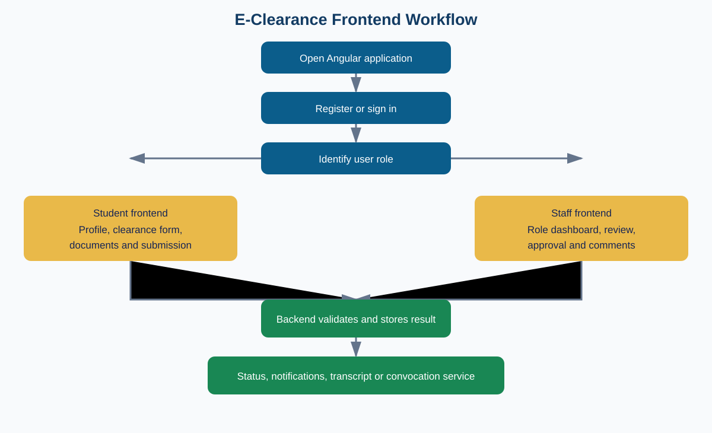
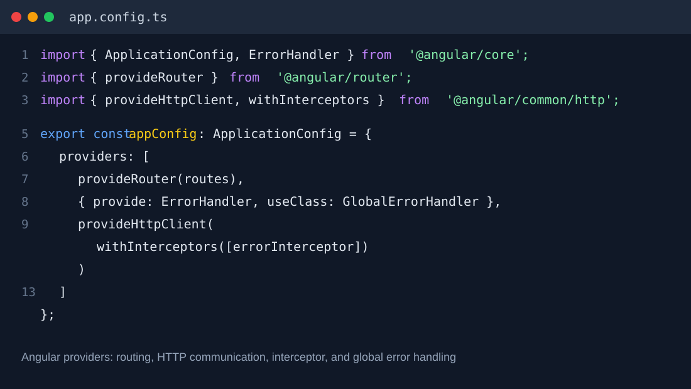
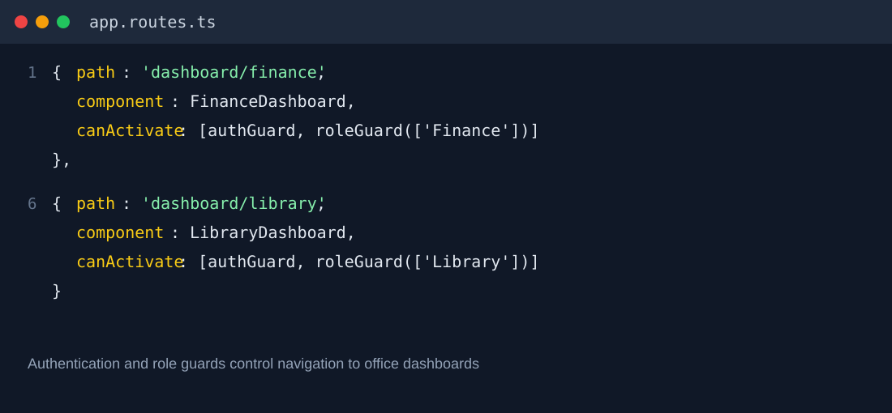

# Frontend Documentation Analysis Report

## e-Clearance Management Information System (e-Clearance MIS)

**Institution:** University of Dar es Salaam (UDSM)  
**System area:** Web frontend  
**Primary location:** `FRONTEND/angular-app`  
**Technology:** Angular 21 and TypeScript 5.9

---

## Abstract

This report presents the development and analysis of an e-Clearance Management Information System for the University of Dar es Salaam. The problem addressed is the difficulty of managing student clearance through manual and disconnected processes. Students may need to visit several university offices, submit similar information repeatedly, and wait without a clear way to know the progress of their requests. Staff may also experience difficulties when reviewing documents, recording decisions, communicating with students, and tracking requests between offices. These challenges can cause delays, missing information, duplicated work, and limited visibility of the overall clearance process.

To address this problem, a web-based system was developed with an Angular frontend connected to backend services and a database. The methodology used included reviewing the existing clearance activities, identifying the needs of students and university staff, studying the system requirements, designing the user interface and navigation, implementing the main workflows, and analysing the resulting frontend behaviour. The work also involved reviewing authentication, role-based access, forms, API communication, document handling, notifications, status tracking, and the interaction between the user interface and the backend. Functional workflows were traced from registration and login through clearance submission, office approval, document management, transcript requests, and convocation-related activities.

During the practical training period, I gained practical experience in analysing a real information system and working with Angular and TypeScript to develop a single-page web application. I improved my skills in creating user interfaces, configuring routes, developing forms, applying validation, using reusable components and services, communicating with backend APIs, and supporting different user roles. I also gained experience in reading an existing system, documenting its functionality, identifying limitations, and proposing improvements. The main achievement was contributing to a frontend that gives students a central place to submit requests and monitor progress while giving staff an organized way to handle assigned clearance activities.

The report is organized into sections that introduce the system and its objectives, explain the problem and methodology, describe the technologies and architecture, analyse the main functional workflows, discuss navigation and access control, and examine data communication and quality considerations. It also presents the findings, limitations, recommendations, and final conclusion. Some challenges encountered included understanding a system with many user roles and approval stages, maintaining consistent workflow states, handling communication between the frontend and backend, and ensuring that client-side controls are not mistaken for complete security. The report recommends strengthening backend authorization, centralizing environment configuration, reducing reliance on sensitive browser storage, improving automated and accessibility testing, and providing clearer documentation for future maintenance.

---

## Table of Contents

1. [Introduction](#1-introduction)
2. [Purpose and objectives](#2-purpose-and-objectives)
3. [Scope and analysis methodology](#3-scope-and-analysis-methodology)
4. [Chapter 2: Main task](#chapter-2-main-task)
   - [2.1 Background of the E-Clearance Frontend and Existing Process](#21-background-of-the-e-clearance-frontend-and-existing-process)
      - [2.1.1 Problems in the Existing Clearance Process](#211-problems-in-the-existing-clearance-process)
   - [2.2 Proposed Angular Frontend Solution](#22-proposed-angular-frontend-solution)
   - [2.3 Reasons for Selecting Angular](#23-reasons-for-selecting-angular)
   - [2.4 Frontend Workflow and Implementation Requirements](#24-frontend-workflow-and-implementation-requirements)
   - [2.5 Comparison of Alternative Solutions](#25-comparison-of-alternative-solutions)
   - [2.6 Challenges in Frontend Development](#26-challenges-in-frontend-development)
   - [2.7 Task Achievement and Recommendations](#27-task-achievement-and-recommendations)
5. [System context and problem analysis](#5-system-context-and-problem-analysis)
6. [Frontend technologies](#6-frontend-technologies)
7. [Architecture and project organization](#7-architecture-and-project-organization)
8. [Functional analysis](#8-functional-analysis)
9. [Navigation and access control](#9-navigation-and-access-control)
10. [Data and communication analysis](#10-data-and-communication-analysis)
11. [Quality and non-functional analysis](#11-quality-and-non-functional-analysis)
12. [Findings, limitations, and risks](#12-findings-limitations-and-risks)
13. [Recommendations](#13-recommendations)
14. [Conclusion](#14-conclusion)
15. [References](#15-references)

---

## 1. Introduction

The e-Clearance MIS frontend is the browser application through which students and university staff interact with the clearance system. It is the visible and interactive part of the wider system: it presents forms and dashboards, validates user input, displays workflow status, calls backend APIs, and provides feedback when operations succeed or fail.

The frontend is located in `FRONTEND/angular-app`. It is an Angular single-page application (SPA). After the initial page is loaded, Angular Router changes the displayed component as the user navigates. This avoids a complete browser reload for every screen and allows the application to preserve a consistent session and user interface.

The frontend supports two broad user groups:

- **Students**, who register, submit clearance information, monitor approvals, submit documents, request transcripts, and provide payment or collection information.
- **Institutional staff**, who register or sign in according to their role and process requests assigned to offices such as Finance, Library, ICT, Convocation, Department, Principal, Laboratory, Workshop, and other approval units.

This report is an analysis of the implemented frontend. It describes what the source code currently provides and separately identifies improvement opportunities. It does not treat a client-side feature as proof that the corresponding backend authorization, persistence, or institutional policy is complete.

## 2. Purpose and objectives

### 2.1 Purpose

The purpose of this document is to provide a structured technical and functional analysis of the e-Clearance MIS frontend for developers, supervisors, maintainers, and future project contributors.

### 2.2 Objectives

The analysis aims to:

1. Describe the frontend problem domain and the users it serves.
2. Identify the technologies and architectural patterns used.
3. Explain the main user workflows from landing page to transcript collection.
4. Analyse routing, authentication, role handling, forms, services, and data persistence.
5. Assess strengths, limitations, maintainability, usability, and operational risks.
6. Recommend practical improvements for testing, deployment, security, and consistency.

## 3. Scope and analysis methodology

### 3.1 Scope

The analysis covers:

- `FRONTEND/angular-app/src`
- Angular routes and application providers
- Authentication and role guards
- Student and staff registration
- Clearance, document, notification, profile, and transcript workflows
- HTTP communication, error handling, styling, and Local Storage usage
- Frontend build, test, and development configuration

The analysis does not replace a backend security audit, database audit, accessibility conformance audit, or production performance test.

### 3.2 Methodology

The documentation was prepared by:

1. Inspecting the frontend directory structure and package manifest.
2. Reviewing the application bootstrap and route configuration.
3. Tracing representative components, guards, services, models, and shared UI.
4. Comparing API-backed operations with browser-persisted operations.
5. Mapping the implemented features to the student and staff workflows.
6. Recording strengths, limitations, risks, and recommended corrective actions.

The report-writing reference supplied with the project recommends identifying the problem, describing the proposed solution, explaining the justification, presenting functional and technical requirements, discussing alternatives, and concluding with challenges and recommendations. Those elements are included here in a form appropriate for a software frontend analysis.

## Chapter 2: Main task

### 2.1 Background of the E-Clearance Frontend and Existing Process

#### 2.1.1 Problems in the Existing Clearance Process

The main task during my practical training period was to analyse and support the development of the frontend for a web-based e-Clearance Management Information System at the University of Dar es Salaam. The problem identified was that clearance involves several offices, documents, decisions, and status changes. When these activities depend on physical visits and disconnected records, students may not know which office is processing their request, which requirements are incomplete, or what action they should take next.

Staff may also spend time searching for documents, repeating data entry, communicating status manually, and maintaining separate records. These difficulties affect transparency, processing time, communication, and record management. They may result in misplaced documents, duplicated submissions, inconsistent decisions, and delays in completing clearance.

My main task therefore focused on understanding the clearance workflow and developing and analysing an Angular frontend that makes the process accessible, organized, and easier to follow. The frontend is the part of the system that students and staff see in the browser. It presents pages, forms, dashboards, status information, notifications, and actions, while backend services handle official processing and storage.

### 2.2 Proposed Angular Frontend Solution

The proposed solution is a centralized web application with an Angular and TypeScript frontend connected to backend services, a database, and secure document storage. The frontend allows students to register, sign in, complete their profiles, submit clearance information, upload supporting documents, view office decisions, receive notifications, and monitor request progress. Staff use role-specific screens to review and process requests assigned to their offices, while administrators support monitoring and management activities.

The frontend is organized as a single-page application. Angular Router changes the displayed page without requiring a complete browser reload. Components present the screens, templates define their structure, CSS controls appearance and responsiveness, services communicate with backend APIs, models describe application data, and guards control navigation according to authentication and role. This separation makes the application easier to maintain because user-interface responsibilities are separated from reusable communication logic.

The solution was developed based on the following assumptions:

- Students and staff have access to a web browser and an internet connection or university network.
- Every user has a unique account and is assigned the correct role by the authorized institution.
- University offices agree on clearance stages, required documents, and status meanings.
- The backend and database remain the authoritative source for users, approvals, payment verification, documents, and official records.
- The institution provides secure hosting, backups, authentication settings, file storage, and technical support.
- Staff receive appropriate training before the system is used for official clearance processing.

### 2.3 Reasons for Selecting Angular

An Angular web application was selected because it provides one interface that can be accessed through common desktop and mobile browsers without installing separate software for every user. Angular supports reusable components, routing, reactive forms, validation, dependency injection, services, HTTP communication, and testing. These features are appropriate for a clearance system with many screens that share user information, statuses, permissions, and feedback.

The centralized approach was selected instead of separate office applications because clearance is a connected process. A shared request allows relevant offices to process the same student information, documents, and status history according to their permissions. It reduces repeated data entry and gives students one place to monitor progress.

Separating the frontend from the backend also improves maintainability. The frontend is responsible for presentation, user input, navigation, validation, and feedback. The backend is responsible for business rules, authorization, database persistence, payment confirmation, document ownership, and official workflow decisions. This separation allows the interface to change without rewriting the complete business system.

### 2.4 Frontend Workflow and Implementation Requirements

The solution flow is presented as an image rather than a text sketch.



**Figure 2.1: Main e-Clearance frontend workflow.** The image shows how registration and login lead to role-specific activities. Students complete forms and upload documents, while authorized staff review and process requests through the backend.

#### 2.4.1 Angular Application Foundation

The Angular frontend uses application providers for routing, HTTP communication, error interception, and global error handling. These providers are registered when the application starts and are then available to the relevant components and services.



**Figure 2.2: Angular application configuration and service providers.** This code screenshot shows the technical foundation used to start the frontend, route users, communicate with backend services, and handle errors consistently.

#### 2.4.2 Account Registration and Secure Login

The first stage is account access. Students and staff register using the information required by the institution and then sign in with their credentials. The frontend validates required fields before sending the request. After successful authentication, the response is normalized into the frontend user model, the role is identified, and the user is redirected to the correct dashboard.

The authentication area also supports password recovery, password reset, profile retrieval, profile update, logout, and expired-session handling. Credential verification and token issuance remain backend responsibilities. The frontend provides the forms, sends requests, stores session information according to the application design, and displays the result.

#### 2.4.3 Student Clearance Form and Submission

The student clearance form collects academic, personal, residence, sponsorship, contact, and supporting information. Reactive form validation helps prevent incomplete or incorrectly formatted submissions. Dependent selections can be used where one academic choice affects another, such as college, department, and programme.

The student reviews the information before confirmation and submission. After submission, the request is associated with relevant approval offices. The student can use status, history, confirmation, report, notification, and dashboard screens to understand progress.

#### 2.4.4 Supporting Document Upload and Verification

The student selects and uploads required supporting documents. The frontend displays document categories, missing requirements, uploaded files, verification status, and officer comments. Authorized officers can review, approve, reject, or request correction of a document.

The backend must validate file type, file size, ownership, access permission, and storage safety. The frontend must not display a document as officially verified until the backend confirms the decision.

#### 2.4.5 Role-Based Office Dashboards and Approvals

After submission, the request is processed by offices according to their responsibilities. An authorized staff member opens a role-specific dashboard, views assigned requests, examines the information and documents, and records an approval, rejection, or request for additional information. A decision may include a comment to guide the student.



**Figure 2.3: Protected role-specific routes.** This code screenshot shows that authentication and role guards direct users to the dashboards intended for them. These frontend controls improve navigation but must be supported by backend authorization.

#### 2.4.6 Notifications, Transcript, and Convocation Features

Notifications inform users about submission results, office decisions, missing documents, and other changes. The transcript workflow allows a student to submit a request, receive payment instructions, upload payment evidence where required, wait for authorized verification, and select collection or delivery information. Convocation-related activities are represented through dedicated screens and approval responsibilities.

#### 2.4.7 API Communication and Frontend Error Handling

The Angular frontend communicates with backend services through HttpClient and RxJS observables. Services keep API logic separate from page components. When a request succeeds, the interface updates the relevant view. When it fails, the error interceptor handles common situations such as invalid input, unauthorized access, missing resources, conflicts, server failures, and network errors.

#### 2.4.8 Functional Requirements of the Frontend

1. The system must allow users to register, sign in, sign out, and recover access.
2. The frontend must display screens and actions according to the authenticated user's role.
3. Students must be able to create, validate, review, and submit clearance information.
4. Students must be able to upload and view required supporting documents.
5. Authorized staff must be able to view assigned requests and record decisions with comments.
6. The system must display current status, outstanding requirements, history, and notifications.
7. The system must support transcript, payment, collection, and convocation stages where applicable.
8. The backend must validate ownership, roles, document access, status transitions, and official records.

#### 2.4.9 Technical, Hardware, and Software Requirements

- **Development environment:** Angular, TypeScript, a modern web browser, a JavaScript package manager, backend API services, a database, secure file storage, and notification services where required.
- **Development hardware:** A computer with enough memory and storage to run the editor, browser, frontend tools, backend service, and database.
- **Production environment:** A reliable server or cloud environment, HTTPS, database backups, access control, monitoring, and sufficient storage for uploaded documents.
- **Quality requirements:** The interface should be tested on common desktop and mobile screen sizes, and important workflows should be tested for success, validation failure, network failure, expired sessions, and duplicate submission.

### 2.5 Comparison of Alternative Solutions

Several alternatives were considered:

- **Paper forms and physical office visits:** This approach is familiar and inexpensive to begin, but it is slow, difficult to audit, vulnerable to lost documents, and does not provide real-time status.
- **Email, spreadsheets, and shared folders:** These tools are easy to introduce, but they create duplicated data, weak permissions, inconsistent workflow, and poor history.
- **Separate applications for each office:** Each office could customize its own interface, but development would be duplicated and a student would not have one complete view of the request.
- **Native mobile application only:** A mobile application could provide mobile-specific features, but it would require installation and separate maintenance and would exclude users without compatible devices.
- **Centralized Angular web application:** This provides browser access, reusable components, connected workflows, and future extensibility, although it requires reliable hosting, security controls, maintenance, and user training.

The centralized Angular web application was selected because it provides the best balance between accessibility, workflow integration, maintainability, and future expansion. A responsive web interface can support mobile users without requiring a separate mobile application at the initial stage.

### 2.6 Challenges in Frontend Development

The main challenges I encountered were understanding a workflow involving many offices and role permissions, keeping status labels consistent across screens, designing long forms that remain understandable, handling document and payment-related stages, and coordinating frontend behaviour with backend responses. Internet or service interruptions can affect submissions and status updates.

The project also required me to read an existing Angular codebase, trace a user's journey across components and services, identify where information is stored, and distinguish temporary browser state from authoritative server data. Another important challenge is that client-side route guards improve navigation but cannot provide complete security; the backend must independently validate every protected operation.

These challenges gave me practical experience in software analysis, Angular interface development, debugging, documentation, API integration, and system improvement. They also showed the importance of shared API contracts, consistent role and status definitions, realistic test data, code review, and communication between developers and institutional stakeholders.

### 2.7 Task Achievement and Recommendations

#### 2.7.1 Achievement of the Main Task

The main task achieved its purpose by analysing the clearance problem and supporting the development of an Angular frontend for the e-Clearance Management Information System. The frontend provides registration, authentication, role-based dashboards, clearance forms, document handling, office approval interfaces, notifications, status tracking, transcript services, and convocation-related screens.

The practical training improved my ability to apply classroom knowledge to a real software system. I gained experience in Angular component development, TypeScript, reactive forms, client-side validation, routing, route guards, HTTP services, observable-based operations, error handling, responsive interface design, and technical documentation. I also learned that a frontend feature must be checked across the complete workflow: screen, API request, backend response, authorization rule, error state, and refresh behaviour.

#### 2.7.2 Recommendations for Further Improvement

**1. Further studies**

- Study backend authorization, database design, audit logging, and workflow engines in greater depth within the next three to six months.
- Conduct usability and accessibility testing with students and staff before wider deployment.
- Investigate progressive web application features, reporting, analytics, and integrations with institutional systems.

**2. PT programme improvement**

- Assign students a complete supervised feature with documented requirements, testing, deployment, and user feedback.
- Include code review, version control, issue tracking, database, API, and deployment activities in the training timetable.
- Provide scheduled demonstrations with academic supervisors and organization mentors.

**3. Recommended study areas before similar tasks**

- Angular, TypeScript, HTTP APIs, authentication, authorization, reactive forms, and validation.
- Relational database concepts, software architecture, testing, Git, debugging, and secure file handling.
- User experience, responsive design, accessibility, data privacy, and secure software development.

**4. Improvement of PT programme and institutional collaboration**

- Provide students with a clear system brief, a safe development environment, and anonymized sample data.
- Define a mentor and supervisor feedback schedule at the beginning of training.
- Give students opportunities to test, document, deploy, and present their work.
- Maintain a structured handover process so useful student improvements can be reviewed and continued after practical training.

## 5. System context and problem analysis

### 5.1 Problem being addressed

Clearance and transcript activities involve multiple offices, repeated document exchanges, status decisions, and communication with students. A process that depends mainly on physical forms or disconnected office records can make it difficult to know which office currently holds a request, determine whether all approvals are complete, submit and verify documents, communicate decisions consistently, track payment and transcript stages, and provide students with one view of progress.

### 5.2 Proposed frontend solution

The frontend addresses the user-facing part of this problem by providing a common web entry point, role-specific dashboards, validated forms, status and history screens, document interfaces, notifications, and transcript and collection workflows. The backend remains responsible for authoritative persistence, business rules, payment confirmation, and server-side authorization.
## 6. Frontend technologies

| Technology | Use |
|---|---|
| Angular 21 | Application framework, standalone components, dependency injection, routing, and build process |
| TypeScript 5.9 | Application language, types, interfaces, and classes |
| HTML | Component templates and semantic page structure |
| CSS | Global and component-specific presentation |
| Angular Reactive Forms | Form state, validation, and conditional form rules |
| Angular HttpClient | Communication with backend endpoints |
| RxJS 7.8 | Observable-based asynchronous operations |
| Angular Router | URL navigation and route protection |
| Local Storage | Selected session, draft, notification, and workflow state |
| npm and Angular CLI | Dependency management, development server, builds, and tests |
| Vitest and Angular testing tools | Unit and behavior testing |

The application uses standalone components rather than the older NgModule-centered organization. Each component can declare the dependencies it needs, which makes its local structure easier to inspect and reduces module configuration overhead.

## 7. Architecture and project organization

### 7.1 Application startup

The browser loads `src/index.html`, which contains the application host element. `src/main.ts` calls `bootstrapApplication` with the root `App` component and `appConfig`.

The application configuration provides:

1. Angular Router and the route table.
2. Angular HttpClient.
3. The HTTP error interceptor.
4. The global error handler.

### 7.2 Main architectural layers

| Layer | Responsibility |
|---|---|
| Components | Render screens, collect user input, respond to events, and coordinate operations |
| Templates | Define page structure, form controls, tables, cards, and feedback elements |
| Services | Encapsulate authentication, clearance, documents, notifications, transcript, storage, and API operations |
| Models | Describe users, requests, documents, dashboards, approvals, notifications, and payment data |
| Guards | Decide whether a route may be activated |
| Interceptors and handlers | Provide consistent HTTP and unexpected-error behavior |
| Shared UI | Reuse headers, dashboards, toast messages, and common presentation behavior |
| Local Storage | Preserve selected client-side state between views or browser sessions |

### 7.3 Project structure

```text
FRONTEND/angular-app/
├── public/                         Static assets and institutional branding
├── src/
│   ├── index.html                  Browser entry document
│   ├── main.ts                     Application bootstrap
│   ├── styles.css                  Global styles
│   └── app/
│       ├── app.ts                  Root component
│       ├── app.config.ts           Providers and application configuration
│       ├── app.routes.ts           Route definitions
│       ├── auth/                   Login, registration, and password screens
│       ├── clearance/              Student clearance screens
│       ├── clearenceapproval/      Approval-office screens
│       ├── dashboard/              Student and institutional dashboards
│       ├── documents/              General and transcript documents
│       ├── notifications/          Notification screen
│       ├── profile/                Profile screen
│       ├── transcript/              Transcript workflow screens
│       ├── core/                   Guards, handlers, interceptors, models, services
│       └── shared/                 Reusable interface components
├── angular.json                    Angular build configuration
├── package.json                    Scripts and dependencies
└── proxy.conf.json                 Development API proxy
```

## 8. Functional analysis

### 8.1 Public entry and account creation

The landing page presents the UDSM identity, application introduction, and entry points for sign-in or account creation. The signup-options page separates student registration from staff registration.

The student registration form collects names, registration number, award or programme level, contact information, password confirmation, and terms acceptance. It validates required values, email format, password length, matching passwords, and terms acceptance before sending the registration request.

The staff registration form collects staff identity, official contact details, institutional role, and conditional organizational information. College, department, and laboratory fields are required according to the selected role. This allows different office responsibilities to be represented by one registration workflow.

The authentication area also includes login, forgot-password, reset-password, profile retrieval, profile update, password change, refresh-token, account activation/deactivation, and logout behavior.

### 8.2 Login and session establishment

The login flow is:

1. The user enters an identifier and password.
2. Reactive Forms checks the required values and password length.
3. `AuthService` sends credentials to the backend.
4. The response is normalized into the frontend user model.
5. The user role is normalized into the role names used by routes.
6. The user and token are stored through the storage service.
7. The user is redirected to the role-appropriate dashboard.

The response normalization is important because backend payloads may use names such as `user_id` and `full_name`, while frontend models use their own naming conventions.

### 8.3 Student clearance workflow

The clearance request form includes student identity, college, department, programme, residence, sponsor, supporting evidence, photograph, and confirmation fields. Academic selections are dependent: a college determines available departments, and a department determines available programmes.

The expected workflow is:

1. Student signs in.
2. Student opens the clearance request page.
3. Student enters or confirms academic and residence information.
4. Student saves a draft where supported.
5. Student confirms and submits the request.
6. The request is associated with the relevant approval offices.
7. Student follows progress through status, confirmation, history, report, notifications, and dashboard views.

The frontend represents common approval stages such as Convocation, independent clearance offices, Department, Principal, and Finance. Additional stages may be included for particular colleges, including Workshop for CoET and Laboratory for MCHAS.

### 8.4 Office dashboards and approvals

The route configuration provides dashboards for Finance, Library, ICT, Academic Staff, Administrator, Games Coach, Hall Warden, USAB, DARUSO, Dean of Students, Smart Card, Principal, Workshop, Laboratory, Department, and Convocation.

Office components give staff a focused interface for requests assigned to their role. The Department workflow also includes a request review route with an ID parameter. Student-facing dashboard cards translate approval records into understandable office names and statuses.

### 8.5 Documents

The document area supports:

- selecting and uploading files with `FormData`;
- retrieving a student's documents with pageable requests;
- retrieving document categories and missing-document information;
- checking whether required documents exist;
- displaying verification status;
- verifying or rejecting documents with an officer comment; and
- deleting documents where the user is authorized.

The component handles the file-selection experience while `DocumentService` encapsulates HTTP and authorization details.

### 8.6 Notifications and profiles

`NotificationService` creates and retrieves notifications, tracks read state, and supports individual or bulk read actions. Shared toast messages provide immediate success, warning, and error feedback.

The profile screen uses authentication services to load and update user data. The student dashboard can also display a profile photograph from user data or the latest clearance request where available.

### 8.7 Transcript workflow

The transcript area separates applicant information, processing, payment, collection, Finance verification, and transcript documents.

The student:

1. Opens the transcript request screen.
2. Confirms identity and graduation information.
3. Accepts the terms and submits the request.
4. Requests a control number.
5. Pays using the control number.
6. Uploads a receipt.
7. Waits for Finance verification.
8. Selects physical collection or DHL delivery.
9. Provides a posting address when delivery is selected.

The implemented payment logic treats the first request as one transcript at TZS 15,000 and later requests as TZS 5,000 per copy. The service records control numbers, receipt information, collection method, posting address, and relevant timestamps. The interface also prevents an additional request while an earlier request is awaiting verification.

## 9. Navigation and access control

### 9.1 Public routes

Public routes include:

- landing page;
- login;
- signup options;
- student registration;
- staff registration;
- forgot-password; and
- reset-password.

### 9.2 Protected routes

Protected routes cover student dashboards, office dashboards, clearance screens, transcript screens, documents, notifications, and profiles. `authGuard` checks whether a user is logged in and redirects unauthenticated users to `/login`.

`roleGuard` compares the normalized current role with the roles allowed by a route. If the role is not allowed, the user is redirected to a dashboard associated with the role. This improves navigation behavior and prevents accidental access through manually entered URLs.

### 9.3 Security boundary

Route guards are a client-side convenience and must not be treated as the security boundary. A user can inspect or modify browser code and storage. Every protected API operation must independently validate the authenticated identity, role, ownership, and business rule on the backend.

## 10. Data and communication analysis

### 10.1 HTTP communication

The frontend uses Angular HttpClient and RxJS observables for asynchronous API operations. The configured development API base is `http://localhost:8080/api/v1`, while `proxy.conf.json` supports development proxying.

The error interceptor handles common responses:

| Response | Frontend interpretation |
|---|---|
| `0` | Connection or network failure |
| `400` | Invalid request |
| `401` | Authentication failure or expired session |
| `403` | Access denied |
| `404` | Resource not found |
| `409` | Conflicting request |
| `500+` | Server-side failure |

For non-login `401` responses, the interceptor clears the local session and routes the user to login. Toast display can be suppressed with `X-Skip-Error-Toast`, and errors are logged for diagnosis.

### 10.2 Persistence strategy

`StorageService` wraps browser Local Storage and serializes objects and arrays as JSON. Current client-side values include the user session and token, clearance drafts or requests, notifications, transcript decisions and payment requests, receipt data, and print state.

This creates a hybrid persistence model:

- API calls provide server communication for selected operations.
- Local Storage provides drafts, UI state, and some workflow records.

Local Storage is useful for temporary client state but is readable and changeable by the browser user. It is not appropriate as the authoritative source for approval, payment, authorization, or sensitive institutional records.

## 11. Quality and non-functional analysis

### 11.1 Maintainability

The component/service/model separation is a positive maintainability feature. Standalone components make dependencies visible, while shared services reduce repeated API and storage code. The route table also provides a central inventory of supported screens.

The main maintainability concern is duplication between API-backed state and locally simulated or locally cached workflow state. If both paths remain, ownership and synchronization rules should be documented for each field.

### 11.2 Usability

Reactive validation, role-specific dashboards, staged workflows, status cards, toast messages, and notification screens support discoverability and immediate feedback. The workflow is organized around the actual responsibilities of students and offices rather than exposing backend operations directly.

Usability should be validated further with real users, especially for long clearance forms, error recovery, document upload feedback, mobile layouts, and transcript payment states.

### 11.3 Reliability and error recovery

Centralized error handling gives common failures consistent behavior. Session expiry is handled by clearing the session and redirecting to login. However, reliability also depends on the backend being available and on server state remaining authoritative when a browser is refreshed, cleared, or used from another device.

### 11.4 Security and privacy

The frontend includes route-level role checks and centralized handling of unauthorized responses. These are useful controls but do not replace backend authorization. Storing tokens, receipt data, profile information, or workflow records in Local Storage increases exposure to browser compromise and accidental disclosure. Production deployment should minimize sensitive client-side persistence and use a token strategy appropriate to the deployment architecture.

### 11.5 Deployment readiness

The current `localhost` API configuration is suitable for local development but is not a production deployment configuration. Environment-specific API URLs, proxy behavior, build configuration, allowed origins, and secure runtime settings should be defined before deployment.

## 12. Findings, limitations, and risks

### 12.1 Strengths

- Broad coverage of student and institutional workflows.
- Clear separation of components, services, models, guards, and shared UI.
- Explicit standalone component dependencies.
- Reactive forms and conditional validation for complex registration and clearance data.
- Role-aware route navigation for many university offices.
- Centralized HTTP error and unexpected-error handling.
- Reusable document, notification, profile, storage, and transcript services.
- A staged transcript process that reflects payment and collection decisions.

### 12.2 Limitations and risks

1. **Development-specific configuration:** hard-coded local API values make movement between development, testing, and production less reliable.
2. **Hybrid state ownership:** local and server copies of similar workflow data can become inconsistent.
3. **Client-side trust risk:** guards and Local Storage can be altered by the browser user.
4. **Sensitive browser persistence:** tokens, receipts, and workflow data may remain in a user-accessible browser store.
5. **Inconsistent API migration risk:** services that use different persistence paths may produce different behavior after refresh or on another device.
6. **Workflow complexity:** many office routes increase the risk of inconsistent labels, permissions, and repeated UI logic.
7. **Testing visibility:** unit tests exist, but the critical end-to-end transitions between student submission, office decision, payment verification, and collection should be explicitly covered.
8. **Accessibility evidence:** the source structure alone does not demonstrate keyboard, screen-reader, contrast, or error-announcement conformance.

## 13. Recommendations

### Priority 1: Establish authoritative server state

- Make the backend authoritative for clearance requests, office decisions, payment verification, transcript status, and document verification.
- Restrict Local Storage to non-sensitive preferences, temporary drafts, and short-lived UI state.
- Add a refresh/reconciliation operation so the UI reloads authoritative state after login, navigation, and page refresh.

### Priority 2: Separate deployment configuration

- Move API URLs and environment-specific settings into Angular environment or deployment configuration.
- Use one documented configuration path rather than mixing explicit localhost URLs and proxy assumptions.
- Document required backend URL, proxy behavior, build mode, and allowed origins for each environment.

### Priority 3: Strengthen security controls

- Enforce role, ownership, status-transition, and payment authorization on every backend endpoint.
- Minimize sensitive values in Local Storage and define token expiration and logout behavior.
- Validate file type, file size, file ownership, and document access on the backend.
- Avoid presenting a successful client-side state change until the server confirms it.

### Priority 4: Improve verification and testing

- Add integration tests for login redirection, role denial, clearance submission, document verification, transcript payment states, and session expiry.
- Add end-to-end tests for the complete student journey and at least one office approval journey.
- Test network failures, duplicate submissions, expired sessions, refreshes, and multi-device access.
- Add accessibility checks for forms, keyboard navigation, labels, focus management, contrast, and error announcements.

### Priority 5: Improve maintainability and operations

- Define shared workflow status and role constants to avoid inconsistent spelling and labels.
- Consolidate repeated dashboard behavior into reusable components where the user experience is the same.
- Add a frontend architecture guide and API contract references for future maintainers.
- Add structured client logging that avoids exposing personal, token, or payment data.

## 14. Conclusion

The e-Clearance MIS frontend is a substantial Angular SPA that provides the user-facing foundation for UDSM clearance and transcript services. It combines public entry pages, account workflows, role-specific dashboards, reactive forms, document management, notifications, clearance status, transcript payment, and collection screens.

The architecture is understandable and extensible: Angular bootstraps the application, routing selects screens, guards manage client-side navigation, components present and collect data, services communicate with the backend, and shared handlers provide consistent feedback. The main architectural issue is not a lack of screens; it is the need to make data ownership and production security unambiguous.

The recommended direction is to keep the frontend as a clear presentation and interaction layer, move authoritative workflow decisions to the backend, centralize deployment configuration, reduce sensitive browser persistence, and expand automated and accessibility testing. These changes would improve reliability, security, maintainability, and confidence in the system as it moves beyond local development.

## 15. References

1. e-Clearance MIS frontend source code, `FRONTEND/angular-app/src`.
2. e-Clearance MIS frontend package configuration, `FRONTEND/angular-app/package.json`.
3. e-Clearance MIS route configuration, `FRONTEND/angular-app/src/app/app.routes.ts`.
4. e-Clearance MIS application configuration, `FRONTEND/angular-app/src/app/app.config.ts`.
5. Angular documentation, standalone components, routing, forms, and HttpClient.
6. University of Dar es Salaam practical training report-writing sample supplied with the project materials.
