# Chapter: Student Business Process of the e-Clearance Management Information System

The e-Clearance Management Information System is a web portal for University students and staff to manage graduation clearance and transcript requests. Students submit information and supporting evidence online, monitor request progress, and complete the transcript application process. University offices review requests and record their decisions.

> **Screenshot note:** The screenshots show the local Angular UI with fictional demonstration data. Names, registration numbers, email addresses, and payment references shown are not real.
>
> **Message note:** Any suggested student messages in this guide are explanatory examples, not a claim that the portal automatically sends those exact messages.

## 1.0 Introduction

The portal provides a centralized way for students to apply for graduation clearance, upload supporting information, follow office decisions, and continue to transcript acquisition after clearance is complete.

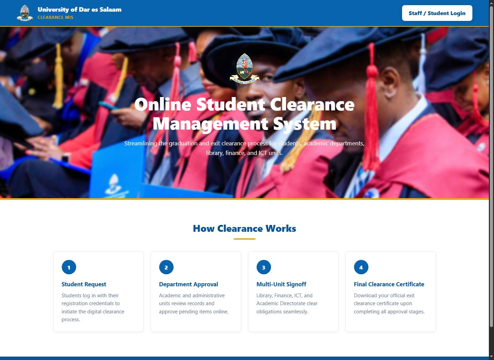

## 2.0 Student Business Process

The student business process consists of graduation clearance followed by transcript application and acquisition. Students must complete the required clearance stages before proceeding to the transcript application.

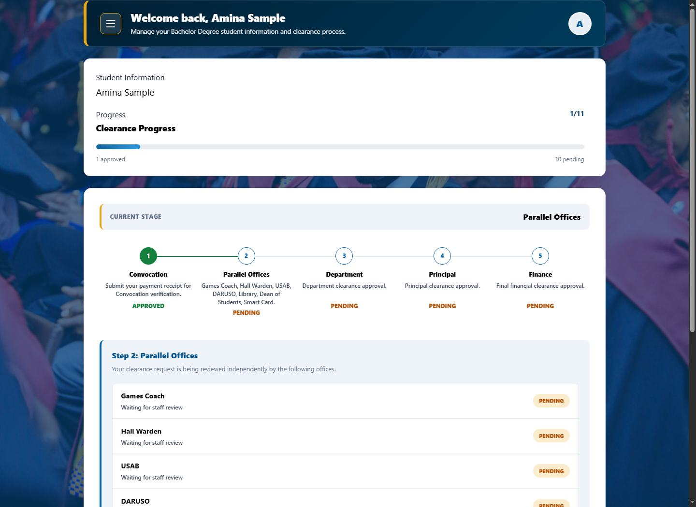

**Overall journey:** Access the portal → sign in → submit clearance request → complete clearance stages 1–5 → confirm clearance completion → apply for a transcript → pay outside the portal → upload the payment receipt → complete the transcript document and collection steps → acquire the transcript.

### 2.1 Accessing the e-Clearance Portal

The public landing page is the entry point for students and University staff. The student selects **Staff / Student Login** to open the authentication page.


**Suggested message**

> Welcome to the e-Clearance Portal. Sign in with your student account to submit and track your University clearance request.

### 2.2 Student Authentication

The student signs in using the registered email address or registration number and password. A student who does not yet have an account can select **Create Account**.

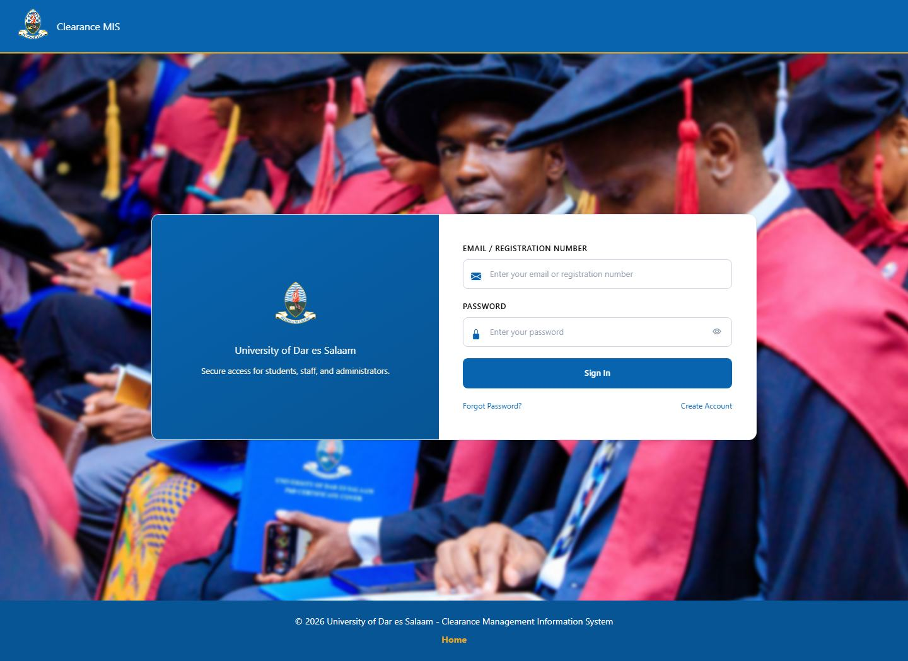

**Suggested message**

> Enter your email address or registration number and password, then select **Sign In**. If you do not have an account, select **Create Account**.

After successful authentication, the portal opens the student dashboard.

#### Creating a New Student Account

Students who do not yet have an account select **Create Account**, choose **Student**, and complete the registration form. The form asks for the student's name, registration number, award, email address, mobile number, password, and acceptance of the terms of service.

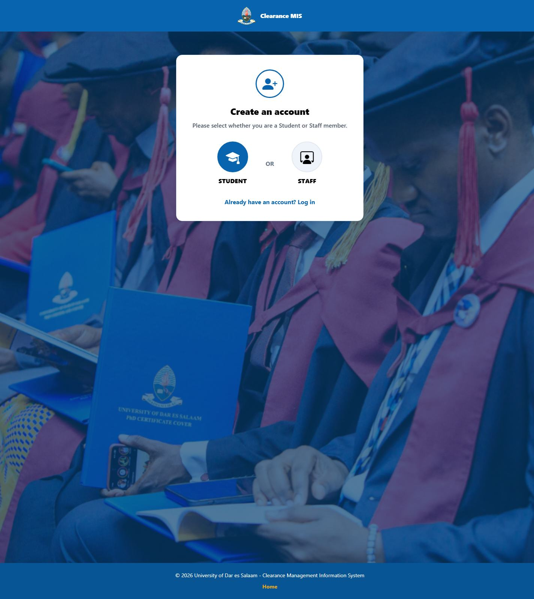


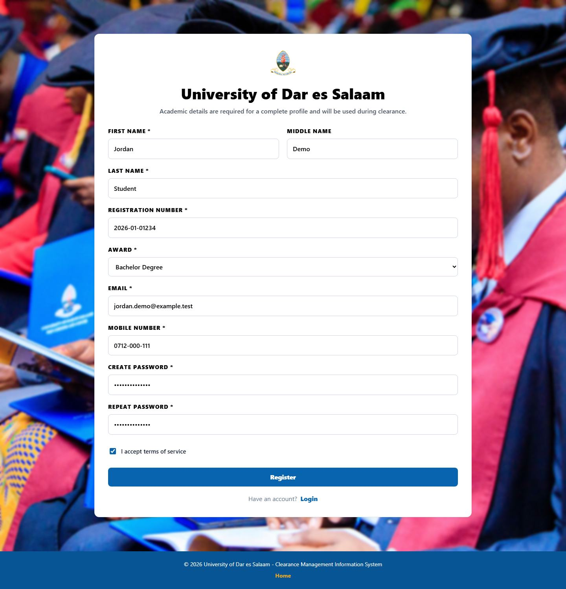

After submitting the form, the portal confirms that the account was created and asks the student to check their email.

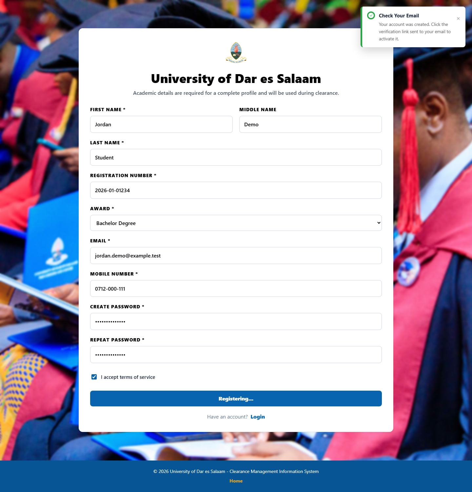

#### Verifying Email and Signing In

The student opens the verification email and follows its link to activate the account. After email verification, they return to the sign-in page and log in using their registered email address or registration number and password. Email activation is required before the student can sign in.

### 2.3 First Student Dashboard

After a new student signs in for the first time, the dashboard displays their student information and shows that no clearance request has been submitted yet.

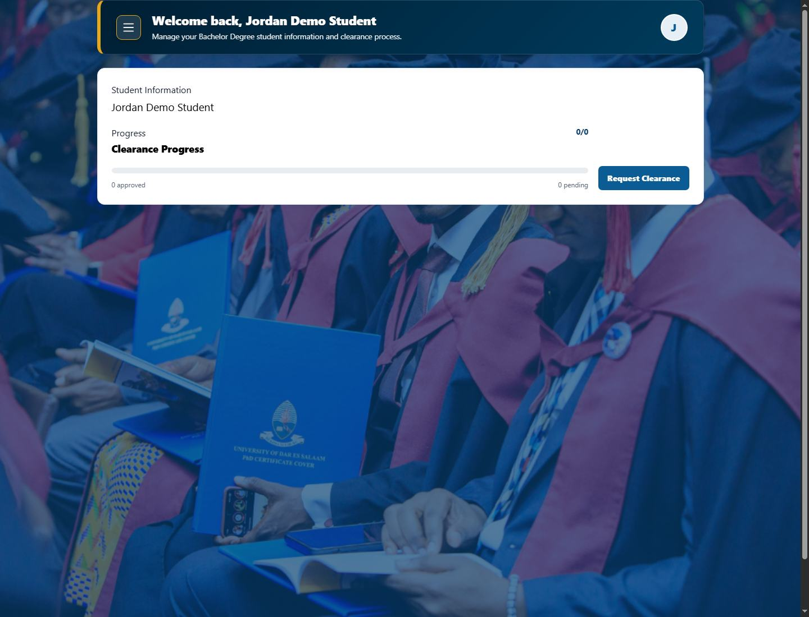

**Suggested message**

> Your dashboard shows your student information and clearance progress. Select **Request Clearance** to start the clearance process.

### 2.4 Submitting a Graduation Clearance Request

The student completes the clearance form with academic, personal, contact, residence, and sponsor information. The student’s name and registration number are populated from the account. The student uploads the requested passport photograph, confirms the information, and submits the request for review.

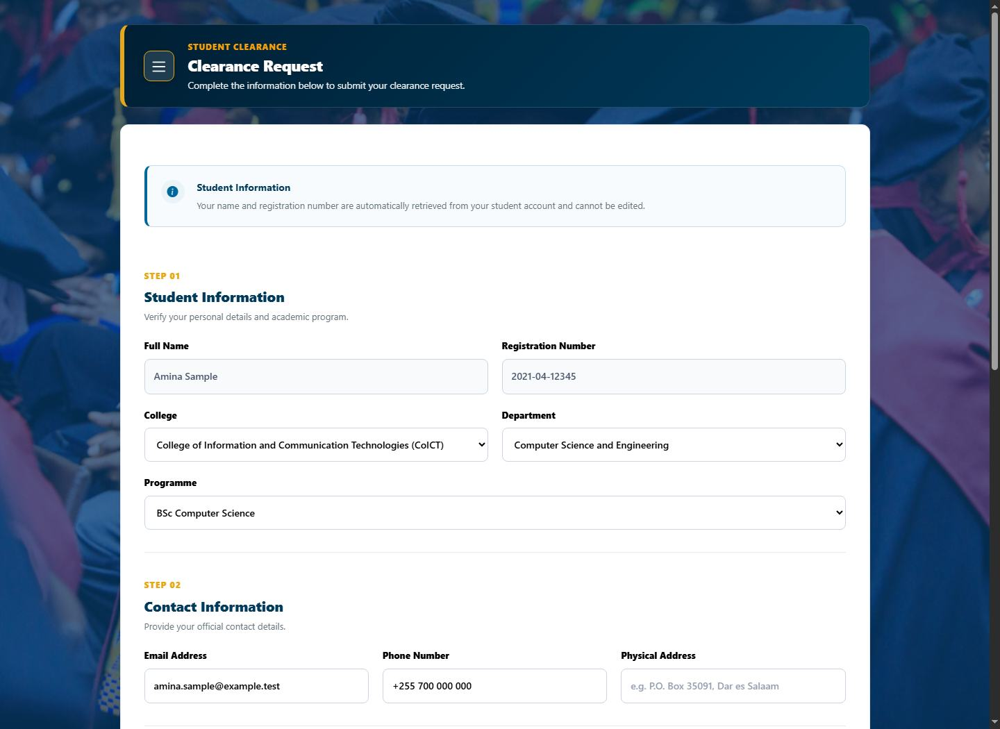

**Suggested message**

> Complete each section of the clearance request. Check that your details are accurate, upload the requested passport photo, confirm the information, and select **Submit Clearance Request**.

After submission, the request enters the University clearance workflow.

## 3.0 Clearance Approval Process

The clearance process has five stages. Its status page shows the current stage and whether each stage is pending, approved, or requires action.

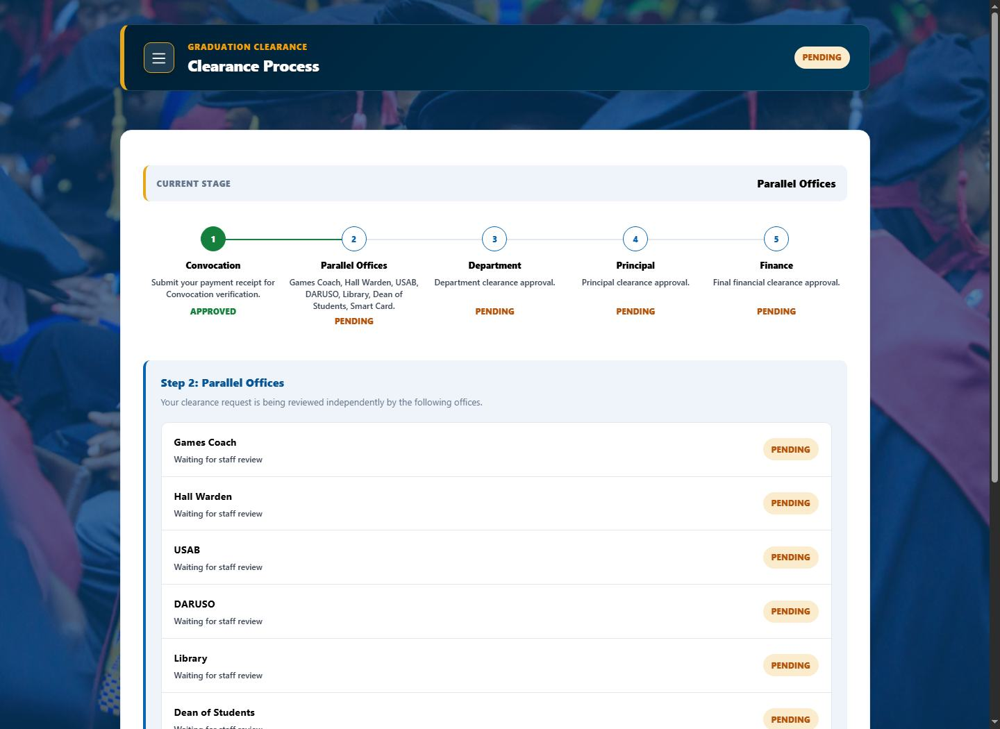

### 3.1 Stage One: Convocation

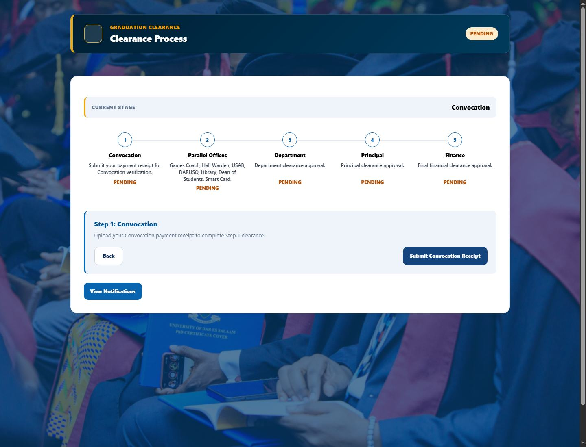

Convocation may require proof of payment. If payment is required, the student pays using the official University instructions outside the portal. The student then uploads a clear photo or scan of the receipt using **Submit Convocation Receipt**. The Convocation office reviews the receipt and records its decision.

**Suggested message**

> If a Convocation payment is required, pay using the official University instructions. Then upload a clear photo or scan of the receipt so the Convocation office can verify it.

**Important:** Uploading a receipt provides proof of payment; the portal does not process the payment itself.

### 3.2 Stage Two: Parallel Clearance Offices

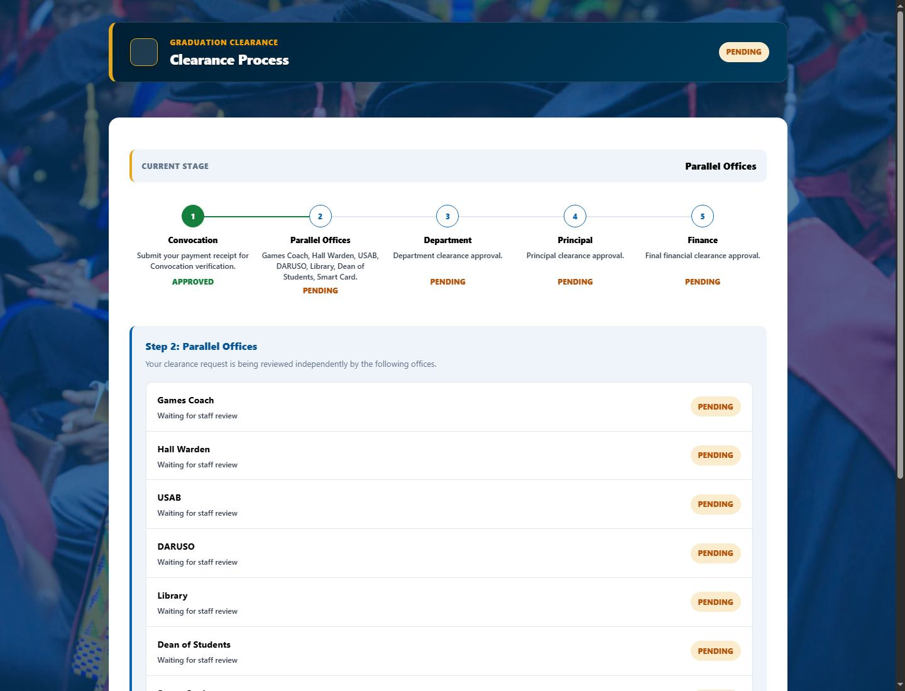

After Convocation approval, several offices review their assigned clearance items independently. The standard list includes:

- Games Coach
- Hall Warden
- USAB
- DARUSO
- Library
- Dean of Students
- Smart Card

Depending on the student’s college, Workshop or Laboratory may also be included. The student can monitor each office’s decision on the Clearance Process page. All applicable offices must approve before the request can proceed.

**Suggested message**

> Your request is being reviewed by the parallel clearance offices. Check the status of each office in the portal. If an office requests a correction, read its comment and provide the requested information.

### 3.3 Stage Three: Department Approval

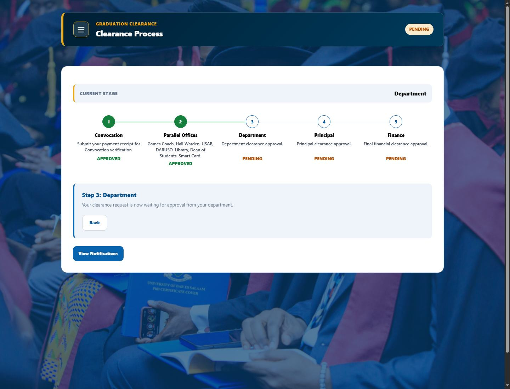

Once all applicable parallel offices have completed their reviews, the Department reviews the clearance request and records its decision.

**Suggested message**

> The parallel office reviews are complete. Your request is waiting for Department approval. Monitor the portal and respond if the Department requests a correction.

If the request is returned, the student reads the staff comment, makes the requested correction, and resubmits the information.

### 3.4 Stage Four: Principal Approval


After Department approval, the request moves to the Principal. The student does not need to submit a new application at this stage; they monitor the existing request.

**Suggested message**

> Department approval is complete. Your request is waiting for Principal approval. Check the portal for the decision or any correction request.

If the Principal returns the request, the student follows the comment and resubmits the corrected information.

### 3.5 Stage Five: Finance Approval

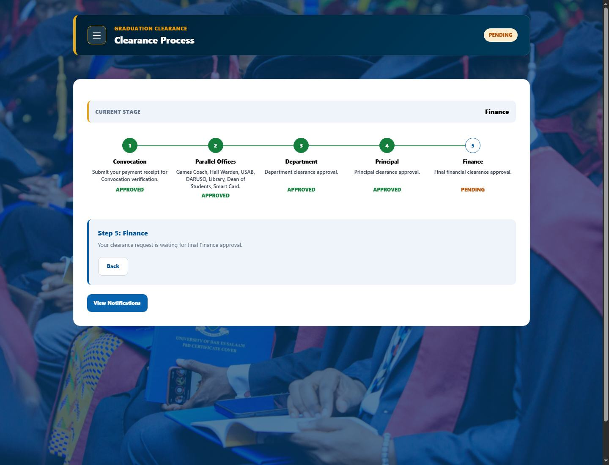

Finance performs the final clearance review. The student monitors the status and responds to any correction request communicated through the portal. When Finance and all other applicable stages approve, graduation clearance is complete.

**Suggested message**

> The earlier clearance stages are complete. Finance is carrying out the final clearance review. You can proceed after Finance approves your request.

## 4.0 Confirmation of Clearance Completion

After all required clearance stages have approved the request, the student can view the completed clearance status and access the clearance certificate. The student then selects **Start Transcript Process** from the completed clearance page or dashboard.

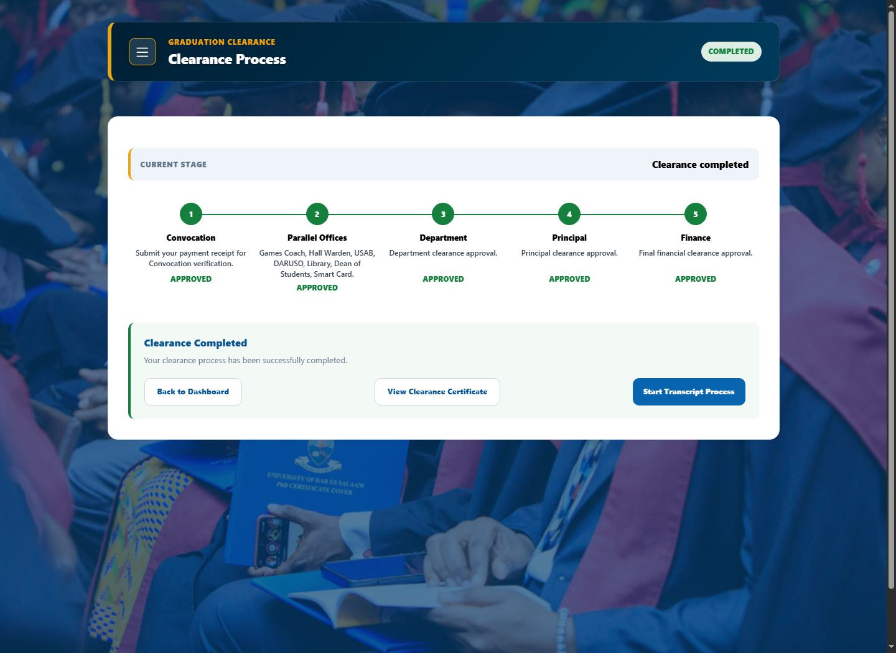

**Suggested message**

> Your graduation clearance is complete. You can view your clearance certificate and start the transcript process.

## 5.0 Transcript Application and Acquisition Process

After graduation clearance, the student completes the transcript application. The process includes reviewing the application, paying externally, uploading proof of payment, submitting academic documents, selecting a collection method, and acquiring the transcript.

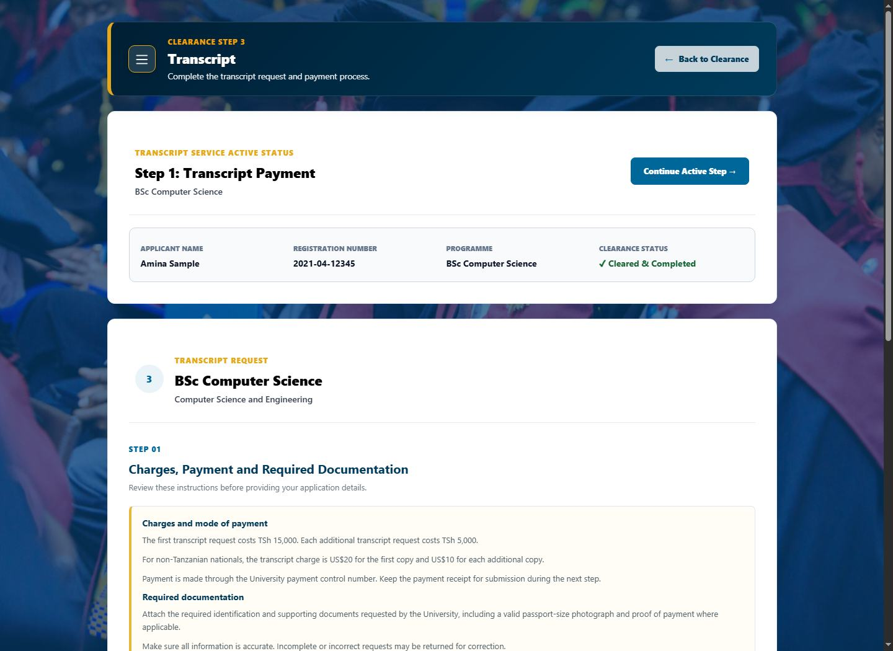

### 5.1 Reviewing the Transcript Application


The student reviews the transcript charges and documentation requirements, confirms the applicant information, provides required contact details, and accepts the terms. The displayed charge for the first transcript request is **TSh 15,000**.

**Suggested message**

> Review the transcript charges and documentation instructions. Confirm your applicant information and contact details, accept the terms, then select **Approve and Proceed to Payment**.

### 5.2 Making Payment and Uploading the Payment Receipt

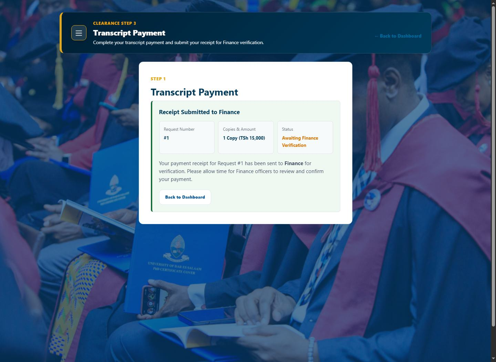

**The portal does not take the payment.** The student first pays the displayed amount outside the portal using the official University payment option. After payment, the student returns to the portal and uploads a photo or PDF of the receipt as proof for Finance.

**Suggested message**

> After you have paid, take a clear photo of your receipt or save it as a PDF. Select **Upload payment receipt**, choose the correct file, and select **Submit Payment Receipt to Finance**.

The receipt should be complete, in focus, and readable. The payment amount, date, and reference should be visible. Avoid blur, glare, and cropping. The portal accepts image or PDF files up to **2 MB**.

After submission, the status appears as **Awaiting Finance Verification**. Finance reviews the receipt and either approves it or returns it with a reason. If it is returned, the student follows the reason and uploads a corrected receipt. The student proceeds only after approval.

### 5.3 Uploading Required Academic Documents

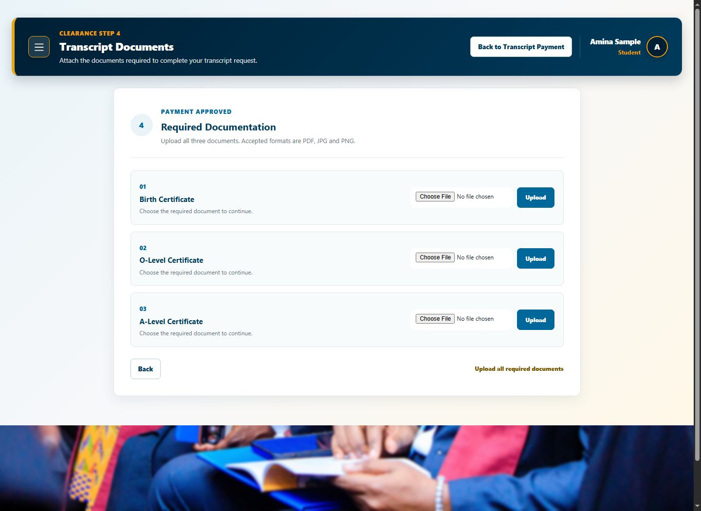

After Finance approves the receipt, the student uploads:

1. Birth Certificate
2. O-Level Certificate
3. A-Level Certificate

The page accepts PDF, JPG, and PNG documents. The student checks that each file is correct and readable, uploads all required documents, and submits them to continue.

**Suggested message**

> Your payment receipt has been approved. Upload each required document in PDF, JPG, or PNG format, then submit the documents to continue.

### 5.4 Selecting the Transcript Collection Method

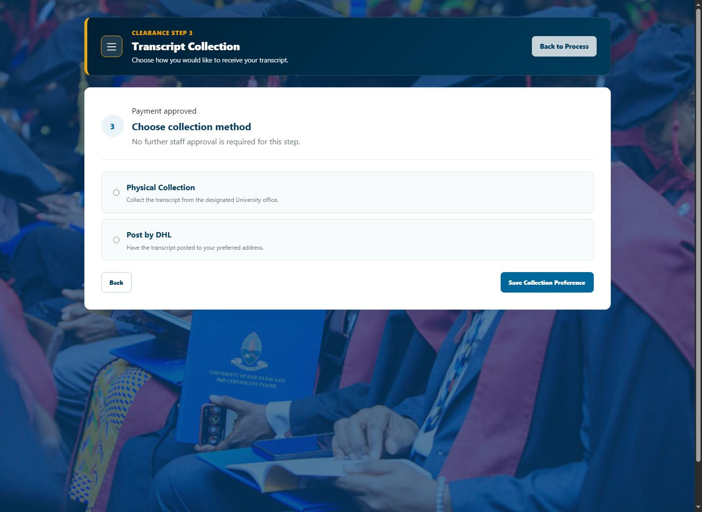

The student chooses one of the collection methods:

- **Physical collection:** Collect the transcript from the designated University office.
- **DHL delivery:** Receive the transcript through DHL. The student provides the requested delivery information.

The student saves the preferred collection method to complete this step.

**Suggested message**

> Choose physical collection or DHL delivery. If you choose DHL, provide the requested delivery details, then save your collection preference.

### 5.5 Acquiring the Transcript

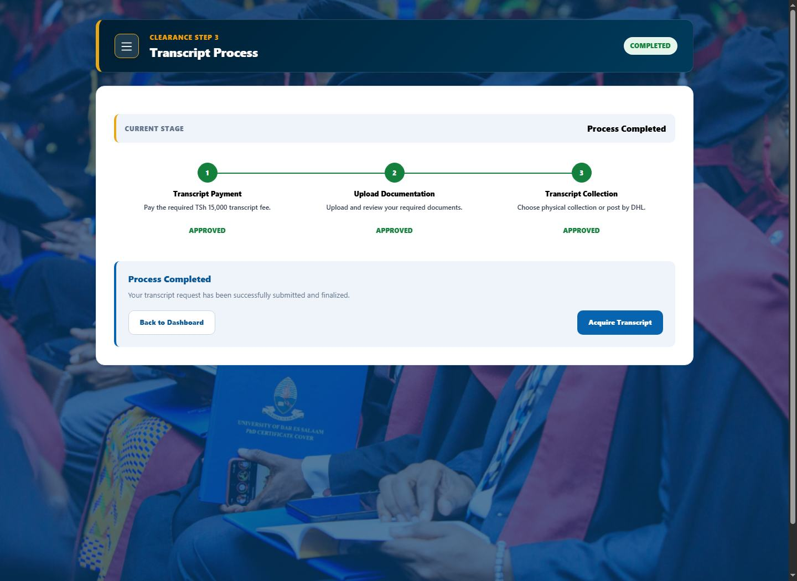

After completing the required transcript steps, the student selects **Acquire Transcript**. This opens a print-ready transcript that can be printed or saved as a PDF using the browser’s **Save as PDF** option.

**Suggested message**

> Your transcript process is complete. Select **Acquire Transcript** to open the print-ready transcript, then print it or save it as a PDF.

Students who need additional copies can start an **Acquire Additional Copies** request, follow the payment instructions shown by the portal, and upload the new payment receipt for Finance verification.

## 6.0 Roles and Responsibilities in the Student Business Process

The student initiates and monitors the process. Clearance offices review assigned clearance items, while Finance reviews submitted payment receipts and records a decision.


| Participant | Responsibilities |
|---|---|
| Student | Provide accurate information, submit the clearance request, make required payments through official University channels, upload receipts and academic documents, monitor progress, respond to correction requests, and select the transcript collection method. |
| Clearance offices | Review assigned clearance items and record approval decisions or requests for correction. |
| Finance Office | Review submitted payment receipts and record whether each receipt is approved or returned. |

The student is responsible for responding to correction requests and providing complete, readable supporting documents before proceeding.

## 7.0 Summary of the Student Business Process

The process begins when the student accesses the portal and ends when the student acquires the transcript. The screenshots below summarize the main checkpoints.


1. The student accesses the public landing page.
2. The student signs in using registered account credentials.
3. The student accesses the dashboard.
4. The student completes and submits a graduation clearance request.
5. If required, the student pays the Convocation fee externally and uploads the receipt.
6. Relevant University offices review the request through the five clearance stages.
7. The student responds to any correction requests.
8. The student views the clearance completion and certificate after all required approvals.
9. The student starts the transcript application.
10. The student reviews transcript charges and application requirements.
11. The student pays outside the portal and uploads a photo or PDF of the payment receipt.
12. Finance verifies the receipt.
13. The student uploads the required academic documents.
14. The student selects a transcript collection method.
15. The student acquires the transcript.

## 8.0 Conclusion

The e-Clearance Management Information System provides a structured process for student graduation clearance and transcript acquisition. Students submit their request and supporting evidence, monitor decisions from the relevant University offices, respond to correction requests, and proceed to transcript application after clearance is complete.

For transcript payment, the student pays through the official University channel outside the portal and uploads the receipt as evidence. Finance verifies that receipt before the student completes the remaining transcript-document and collection steps.


The process ends when the student selects **Acquire Transcript** and opens the print-ready transcript.

## Technology

- **Frontend:** Angular and TypeScript single-page application
- **Backend:** Java-based web services for authentication, workflow processing, and data management
- **Database:** Persistent storage for users, clearance requests, approvals, documents, notifications, and related records

The frontend communicates with backend APIs. Frontend route guards support navigation, while authorization and business rules must also be enforced by the backend.

## Running the frontend

From `FRONTEND/angular-app`, install the dependencies and start the Angular development server:

```bash
npm install
npm start
```

The frontend requires the backend and its local environment configuration for account authentication and live workflow data. Keep credentials, authentication secrets, and real student or payment data out of source control.
